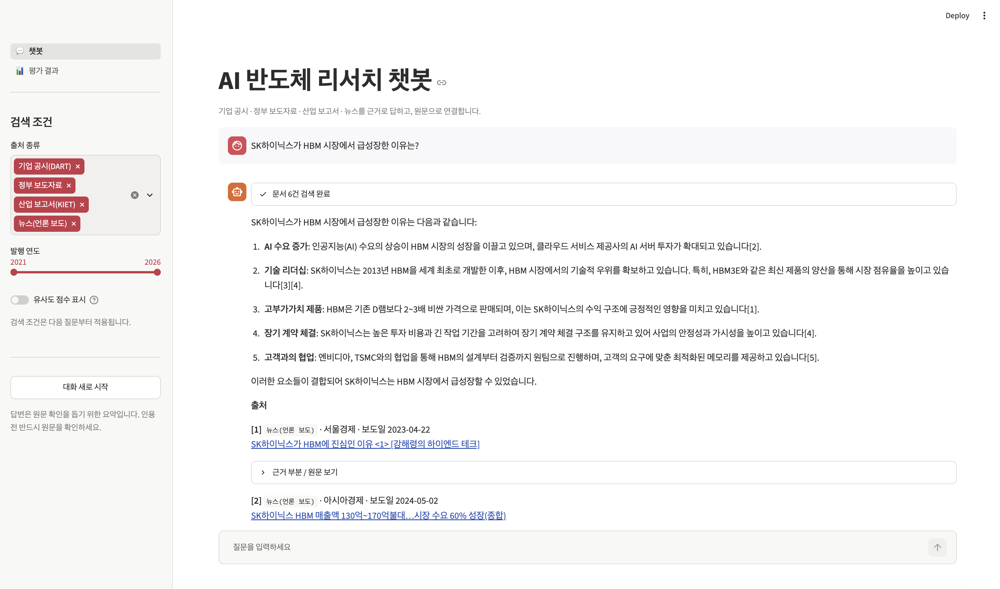
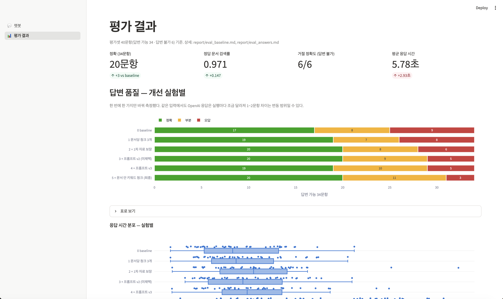

# AI 반도체 산업 동향·기업 전략 분석 RAG 챗봇

미니프로젝트 3 · 주제 B (산업·기술 동향 / AI 반도체)

AI 반도체 산업 동향과 기업 전략을 묻는 질문에 **기업 공시·정부 보도자료·산업 보고서·뉴스를 근거로 답하고, 원문으로 바로 연결**하는 RAG 챗봇.
근거가 없으면 "제공된 자료에서 확인할 수 없습니다"라고 거절한다.

- **대상 사용자**: 반도체·IT 기업 전략기획·산업분석 주니어 담당자 (뉴스·공시·정책·보고서 교차 확인)
- **최종 리포트**: [`report/REPORT.md`](report/REPORT.md)

| 최종 성능 (평가셋 40문항) | baseline | 최종 |
|---|---|---|
| 답변 정확 / 부분 / 오답 (답변 가능 34) | 17 / 8 / 9 | 20 / 11 / 3 |
| 정답 문서 검색률 | 0.824 | 0.971 |
| 답변 불가 질문 거절 (6) | 6 / 6 | 6 / 6 |

<!-- 스크린샷: report/images/ 에 챗봇·대시보드 캡처를 넣고 아래 줄의 주석을 푼다


-->

---

## 계층 구조 (가이드 4-2)

| 계층 | 디렉터리 | 실행 방식 | 역할 |
|---|---|---|---|
| ① 수집기 | `collector/` | 배치 | 제공 뉴스 적재·선별, DART·정책브리핑 수집, KIET 적재 |
| ② 인덱서 | `indexer/` | 배치 | 정제 → 중복 처리 → 청킹(A/B) → 임베딩 → 키워드 색인 |
| ③ 저장소 | `store/` | 상시 존재 | `docs.db`(원문·청크), `chroma/`(벡터), `keyword_B.db`(BM25) |
| ④ 챗봇 | `app/` + `rag/` | 상시 실행 | 검색·생성·UI (조회 전용) |
| 평가 하네스 | `eval/` | 배치 | 챗봇과 **같은** `rag/chain.py` 호출 |

- 챗봇은 질문 임베딩만 만들고 문서 임베딩·크롤링·인덱스 쓰기를 하지 않는다
- 인덱서·수집기 없이 챗봇만 단독 구동된다 (`store/` 만 있으면 됨)
- 계층 공용 모듈: `settings.py`(모델명·경로), `tokenizer.py`(키워드 토큰화)

---

## 실행 순서

### 0. 환경 준비
```bash
conda create -n pjt3 python=3.11 -y
conda activate pjt3
pip install -r requirements.txt
cp .env.example .env      # OPENAI_API_KEY, DART_API_KEY 입력 (커밋 금지)
```
- 제공 뉴스 CSV 는 `data/raw/` 에, KIET 보고서 PDF 는 `data/raw/kiet/` 에 둔다 (저장소 미포함)

### ① 수집 (배치)
```bash
python -m collector                 # 전체
python -m collector --only dart     # 한 소스만: provided | dart | press | kiet
```
→ `store/docs.db` 의 `documents` 테이블, 단계별 건수는 `collect_log`

### ② 인덱싱 (배치)
```bash
python -m indexer                              # 전체: parse → dedup → chunk → embed → keyword
python -m indexer --only embed --config B      # 단계·설정 지정 (OpenAI 키 필요, B 약 54분)
python -m indexer --only keyword --config B    # 하이브리드 검색용 BM25 색인 (약 3분)
```
→ `store/chroma/` (벡터), `store/keyword_B.db` (키워드 색인)

### ④ 챗봇 (상시)
```bash
streamlit run app/main.py
```
- **챗봇** 페이지: 스트리밍 답변, 멀티턴, [n] 번호 출처 목록, 근거 부분·원문 보기, 출처 종류·연도 필터
- **평가 결과** 페이지: 실험별 답변 품질, 유형별·원인별 결과, 검색 지표, 유사도 분포, 지식베이스 구성

### 평가 (배치)
```bash
python eval/run_eval.py --tag baseline          # 검색 품질: Hit@k, MRR (설정 A·B)
python eval/run_answers.py --tag 실험이름        # 답변 생성 + 자동 지표 (OpenAI 호출, 40문항)
python eval/run_answers.py --tag 실험이름 --summary   # 저장된 결과 요약만
python eval/exp_balance.py                      # 실험 2: 1차 자료 보장 비교 (API 호출 없음)
python eval/exp_hybrid.py                       # 실험 5: 하이브리드 검색 비교 (API 호출 없음)
```
- 결과: `eval/results/` (실험 태그별), 채점: `eval/grades_<태그>.json`
- 질문 임베딩은 `data/cache/` 에 캐시되어 같은 질문은 다시 호출하지 않는다

---

## 최종 설정 (`rag/chain.py`, `rag/prompts.py`)

| 항목 | 값 | 근거 |
|---|---|---|
| 임베딩 | OpenAI text-embedding-3-small | 파일럿 Hit@3 동점, 인덱싱 9배 빠름 |
| 청킹 | 설정 B (문서 구조 기반) | Hit@3 0.794 vs 0.706 |
| 생성 모델 | gpt-4o-mini, temperature 0 | `.env` 의 `LLM_MODEL` 로 변경 가능 |
| 검색 | 문서 6개, 문서당 청크 3개 (의미 검색 + 문서 안 키워드 1개), 1차 자료 최소 1개 | 실험 1·2·5 |
| 거절 | 1위 유사도 0.45 미만이면 즉시 거절 + 프롬프트 판단 | 유사도만으로는 거절 판단 불가 (분포 확인) |
| 프롬프트 | v3: 근거 기반·[n] 출처·상충 병기·출처 종류·[연도 기준]·출처 지정 규칙 | 실험 3·4 |

---

## 폴더 구조
```
collector/   ① 수집기          indexer/   ② 인덱서          store/    ③ 저장소 (저장소 미포함)
rag/         검색·체인·프롬프트  app/       ④ 챗봇·대시보드    eval/     평가셋·평가 하네스·결과
notebooks/   EDA               report/    리포트·설계 근거   data/     원본·캐시 (저장소 미포함)
```

## 문서
| 문서 | 내용 |
|---|---|
| [`report/REPORT.md`](report/REPORT.md) | 최종 리포트 (가이드 6장 10개 항목) |
| `report/eval_answers.md` | 답변 평가와 개선 실험 5회 상세 |
| `report/eval_baseline.md` | 검색 1차 측정, 정답 라벨 보완 |
| `report/embedding_decision.md` · `chunk_design.md` · `dedup_decision.md` | 설계 결정 근거 |
| `report/troubleshooting.md` | 개발 중 문제와 해결 기록 |
| `report/plan_6days.md` | 6일 계획과 진행 체크 |
